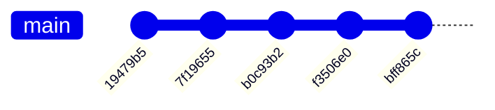

# 📜 Histórico Técnico de Commits (Changelog Completo)

Este documento registra a evolução arquitetural, decisões de engenharia e histórico detalhado de todos os commits do projeto **Local Stream Hub** (`streaming-streaming`).

---

## 📌 Linha do Tempo dos Commits

---

## 🔍 Detalhamento por Commit

### 1. `19479b5` — *chore: initialize frontend dependencies and application structure*
- **Autor:** Charles Egidio
- **Data:** 14/10/2026 19:40:39 -03:00
- **Hash Completo:** `19479b5e629d0a185542a631062d65f8ada75f7f`

#### 🎯 Objetivo & Decisões Técnicas
Criação e estruturação inicial da arquitetura do projeto seguindo os princípios de BFF (Backend for Frontend) autocontido em Go, com frontend Vue 3 embutido e containerização Docker multi-stage:
- **Go BFF (Gin Gonic):** Configuração do servidor HTTP em [`cmd/server/main.go`](file:///home/charles/projetos/streaming-streaming/cmd/server/main.go), middleware CORS, graceful shutdown via `os.Signal` e roteador REST `/api`.
- **Serviço TMDB com Cache em Memória:** Implementação de [`internal/services/tmdb_service.go`](file:///home/charles/projetos/streaming-streaming/internal/services/tmdb_service.go) utilizando `github.com/patrickmn/go-cache` para armazenar em memória metadados do The Movie Database (Trending, Search e Details), atingindo latências inferiores a 2ms nos cache hits.
- **Embedded SPA (`//go:embed`):** Implementação de [`web/embed.go`](file:///home/charles/projetos/streaming-streaming/web/embed.go) e [`internal/handlers/spa_handler.go`](file:///home/charles/projetos/streaming-streaming/internal/handlers/spa_handler.go) para servir os arquivos estáticos do frontend empacotados diretamente dentro do binário final do Go.
- **Frontend SPA (Vue 3 + Tailwind CSS v4 + Pinia):** Estruturação do client em `frontend/` com Composition API (`<script setup>`), stores `media.js` e `player.js`, componentes `MediaCard.vue`, `Navbar.vue` e `PlayerModal.vue`.
- **Docker Multi-Stage:** `Dockerfile` com compilação em 3 estágios (`node:22-alpine` para build do frontend, `golang:alpine` para compilação estática do binário Go e `alpine:3.20` como imagem mínima de execução com usuário não-root `appuser`).
- **Suíte de Testes:** Testes automatizados em `internal/handlers/handlers_test.go` e `internal/services/tmdb_service_test.go`.

#### 📁 Arquivos Criados:
- Backend: `cmd/server/main.go`, `internal/config/config.go`, `internal/handlers/*`, `internal/models/*`, `internal/services/*`, `web/embed.go`.
- Frontend: `frontend/package.json`, `frontend/vite.config.js`, `frontend/src/*`.
- Infra: `Dockerfile`, `.dockerignore`, `.env.example`, `.gitignore`.

---

### 2. `7f19655` — *chore: update build assets and component templates*
- **Autor:** Charles Egidio
- **Data:** 14/10/2026 20:04:21 -03:00
- **Hash Completo:** `7f196553d37ebe3a0cf994ca15eea2af8dada076`

#### 🎯 Objetivo & Decisões Técnicas
Aprimoramento da experiência do usuário referente a títulos não lançados ou indisponíveis no provedor externo de streaming:
- **Identificação de Lançamentos Futuros:** Adicionada computada `unreleasedInfo` em [`frontend/src/components/MediaCard.vue`](file:///home/charles/projetos/streaming-streaming/frontend/src/components/MediaCard.vue) e [`frontend/src/components/PlayerModal.vue`](file:///home/charles/projetos/streaming-streaming/frontend/src/components/PlayerModal.vue) comparando a data de estreia com a data atual.
- **Banner Informativo de 404:** Exibição de aviso claro no modal explicando que filmes ainda em cartaz ou inéditos retornam `404 Not Found` nos provedores de streaming externos porque os arquivos ainda não foram gerados.
- **Badge "Em Breve":** Inclusão de tag visual sobre o pôster nos cards de filmes não lançados.
- **Rebuild de Assets:** Atualização dos chunks Javascript e CSS embutidos em `web/dist/`.

---

### 3. `b0c93b2` — *feat: update player modal component and build assets*
- **Autor:** Charles Egidio
- **Data:** 14/10/2026 20:09:56 -03:00
- **Hash Completo:** `b0c93b2dac06479615e8ac2288382fed4b222656`

#### 🎯 Objetivo & Decisões Técnicas
Melhorias no ecossistema de reprodução de vídeo para Smart TVs, dispositivos móveis e suporte a transmissão externa:
- **Botão "Abrir Player Direto (HTTPS)":** Inclusão de ação no rodapé do modal permitindo abrir o link de streaming diretamente em uma nova aba com conexão segura.
- **Compatibilidade com Casting & Smart TV:** Facilita a transmissão nativa do navegador para Google Cast, AirPlay ou navegadores integrados de Smart TVs.
- **Remoção de Restrições Excessivas:** Ajuste nas propriedades do iframe (retirada de restrições rígidas que quebravam scripts de verificação e reprodutores HLS de terceiros no mobile).
- **Sincronização de Build:** Compilação dos arquivos em `web/dist/` via Vite.

---

### 4. `f3506e0` — *feat: add live TV channels support with streaming player integration and backend services*
- **Autor:** Charles Egidio
- **Data:** 14/10/2026 21:02:50 -03:00
- **Hash Completo:** `f3506e029edf3e19c717a9a373db257cd74e6397`

#### 🎯 Objetivo & Decisões Técnicas
Desenvolvimento e integração completa da funcionalidade de **Canais de TV Ao Vivo** consumindo o catálogo público da SuperFlixAPI:
- **Modelos de Domínio (`internal/models/channel.go`):** Structs `Channel`, `SuperflixChannelResponse` e `ChannelCategoryItem`.
- **Serviço com Resiliência a Rate Limit (`internal/services/channel_service.go`):**
  - Cache em memória com TTL de 60 minutos para o catálogo de canais (`channels:all`).
  - Mutex (`sync.Mutex`) protegendo o método `getAllChannels` contra acessos simultâneos (*thundering herd*).
  - Fallback automático: caso a SuperFlixAPI retorne erro de rate limit (`HTTP 429` ou mensagem de bloqueio temporário), o serviço reutiliza o último snapshot de dados do cache sem derrubar a aplicação.
  - Filtro em memória de alta performance (< 2ms) para busca e categorização.
- **Handlers REST no Gin (`internal/handlers/channel_handler.go`):**
  - `GET /api/channels`: Lista canais com filtros opcionais `?category={slug}&q={termo}`.
  - `GET /api/channels/categories`: Lista todas as categorias existentes ordenadas.
- **Extensão do Resolver (`internal/handlers/player_handler.go`):** Suporte a `type=channel` e `channel_id={slug}` gerando a URL `https://superflixapi.quest/canal/{slug}`.
- **Frontend Vue 3:**
  - Store Pinia `channels.js` gerenciando estado reativo de canais, categorias e computada `filteredChannels`.
  - Componente `ChannelCard.vue` com proporção 16:10, logo do canal, badge pulsante `AO VIVO`, tag de categoria e play overlay.
  - Atualização do `PlayerModal.vue` com indicador de transmissão ao vivo (ícone `Radio` pulsante) e ocultação de controles de temporada/episódio para canais.
  - Seletor de abas no `Home.vue` (`[Filmes]`, `[Séries]`, `[Canais Ao Vivo]`) com pílulas horizontais de categorias.
- **Testes Automatizados:** Criação de `internal/services/channel_service_test.go` e novos cenários em `internal/handlers/handlers_test.go`.

---

### 5. `bff865c` — *feat: add referrer policy to channel logos and implement debounced channel search*
- **Autor:** Charles Egidio
- **Data:** 14/10/2026 23:50:53 -03:00
- **Hash Completo:** `bff865ca828df42f262b7fe6096b321f34434317`

#### 🎯 Objetivo & Decisões Técnicas
Refinamentos arquiteturais decorrentes do ciclo de Code Review & QA:
- **Proteção de Hotlink (`referrerpolicy="no-referrer"`):** Adicionado ao elemento `` em `ChannelCard.vue` para garantir que CDNs externas não bloqueiem os logos por validação do cabeçalho `Referer`.
- **Busca Otimizada com Debounce:** Implementação de controle de tempo de 120ms (`handleChannelSearch`) no input de busca da seção de canais em `Home.vue`, prevenindo recomputações desnecessárias durante a digitação e mantendo a interface em 60 FPS contínuos no mobile.
- **Compilação e Deploy:** Build final do frontend (`index-JGqEV0cI.js`) e reinicialização do container Docker `stream-hub` consumindo apenas **10.9 MB de RAM**.

---

## 📊 Tabela Resumo dos Commits

| Commit | Tipo | Data | Módulos Afetados | Resumo |
| :--- | :--- | :--- | :--- | :--- |
| `19479b5` | `chore` | 14/10/2026 | Backend, Frontend, Docker, Web | Arquitetura inicial Go BFF, TMDB, SPA Embed e Docker multi-stage |
| `7f19655` | `chore` | 14/10/2026 | Frontend (Components, Web) | Aviso informativo sobre filmes não lançados e badge "Em Breve" |
| `b0c93b2` | `feat` | 14/10/2026 | Frontend (PlayerModal, Web) | Botão direto HTTPS e facilidades para Smart TV / casting |
| `f3506e0` | `feat` | 14/10/2026 | Backend, Frontend, Models, Tests | Implementação completa de Canais Ao Vivo, cache e player |
| `bff865c` | `feat` | 14/10/2026 | Frontend (ChannelCard, Home, Web) | Adição de `referrerpolicy="no-referrer"` e debounce na busca |
