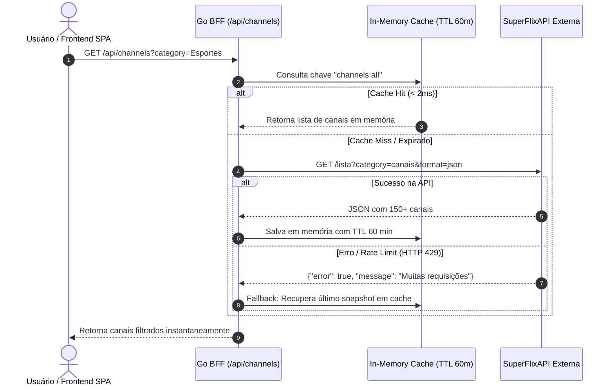

# 📺 Módulo de Canais Ao Vivo (SuperFlixAPI)

Documentação técnica do módulo de transmissão e catálogo de canais de TV ao vivo integrado ao **Local Stream Hub**.

---

## 1. 📝 Registro de Alterações (Changelog)

### Adicionado
- **Serviço de Canais em Go:** Implementado [`internal/services/channel_service.go`](file:///home/charles/projetos/streaming-streaming/internal/services/channel_service.go) gerenciando o consumo da SuperFlixAPI com cache em memória TTL thread-safe (`github.com/patrickmn/go-cache`) e proteção com `sync.Mutex` contra o efeito *thundering herd*.
- **Resiliência a Rate Limit:** Fallback transparente para o último snapshot em cache se a SuperFlixAPI retornar HTTP 429 ou mensagens de limite de requisições.
- **Modelos de Dados:** Structs [`Channel`](file:///home/charles/projetos/streaming-streaming/internal/models/channel.go), `SuperflixChannelResponse` e `ChannelCategoryItem` criados em `internal/models/channel.go`.
- **Endpoints REST no Gin:**
  - `GET /api/channels`: Lista canais com suporte a filtros `?category={slug}` e busca textual `?q={termo}`.
  - `GET /api/channels/categories`: Lista as categorias únicas existentes ordenadas alfabeticamente.
  - `GET /api/player/resolve`: Estendido para suportar `type=channel` e `channel_id={id}` gerando a URL normalizada do iframe `https://superflixapi.quest/canal/{id}`.
- **Testes Automatizados:** Testes unitários de serviços e handlers em `internal/services/channel_service_test.go` e `internal/handlers/handlers_test.go`.
- **Frontend Vue 3:**
  - Store Pinia [`useChannelStore`](file:///home/charles/projetos/streaming-streaming/frontend/src/stores/channels.js) para estado reativo de canais e categorias.
  - Componente [`ChannelCard.vue`](file:///home/charles/projetos/streaming-streaming/frontend/src/components/ChannelCard.vue) com badge pulsante `AO VIVO`, `referrerpolicy="no-referrer"`, fallback gracioso de imagem e play no hover.
  - Aba e filtros com debounce de 120ms na busca em [`Home.vue`](file:///home/charles/projetos/streaming-streaming/frontend/src/pages/Home.vue).
  - Header adaptado e aviso explicativo no [`PlayerModal.vue`](file:///home/charles/projetos/streaming-streaming/frontend/src/components/PlayerModal.vue).

---

## 2. 🚀 Guia de Setup & Execução

### 2.1 Requisitos
- Go 1.24+ (testado e compilado com Go 1.25)
- Node.js 20+ e npm
- Docker (opcional, para execução em container isolado)

### 2.2 Variáveis de Ambiente (`.env`)
Certifique-se de que a variável `SUPERFLIX_BASE_URL` está configurada:
```env
PORT=8080
SUPERFLIX_BASE_URL=https://superflixapi.quest
CACHE_TTL_MINUTES=60
CACHE_CLEANUP_MINUTES=10
GIN_MODE=release
```

### 2.3 Execução Local
```bash
# 1. Build dos assets estáticos do Frontend
cd frontend
npm install
npm run build
cd ..

# 2. Executar o servidor Go BFF
go run ./cmd/server/main.go
```

### 2.4 Execução com Docker
```bash
# Construir imagem multi-stage autocontida
docker build -t local-stream-hub .

# Executar o container mapeando a porta 8080
docker run -d -p 8080:8080 --env-file .env --name stream-hub local-stream-hub
```

---

## 3. 📖 Documentação da API REST & Endpoints (Gin)

| Método | Endpoint URI | Handler | Parâmetros Suportados | Descrição |
| :--- | :--- | :--- | :--- | :--- |
| `GET` | `/api/channels` | `ChannelHandler.GetChannels` | `category` (string, opcional)<br>`q` (string, opcional) | Lista canais ao vivo filtrados por categoria e/ou busca |
| `GET` | `/api/channels/categories` | `ChannelHandler.GetCategories` | Nenhum | Retorna a lista de todas as categorias de canais |
| `GET` | `/api/player/resolve` | `PlayerHandler.Resolve` | `type=channel`<br>`channel_id={slug}` (obrigatório se type=channel) | Gera a URL segura de incorporação do canal |

### Exemplos de Requisição e Resposta

#### Listar canais da categoria Esportes
```bash
curl -s "http://localhost:8080/api/channels?category=Esportes"
```
**Resposta (HTTP 200 OK):**
```json
{
  "total": 2,
  "data": [
    {
      "id": "sportv",
      "name": "SporTV",
      "description": "",
      "logo_url": "https://superflixapi.quest/img/sportv.png",
      "embed_url": "https://superflixapi.quest/canal/sportv",
      "category": "Esportes",
      "is_active": true
    },
    {
      "id": "espn",
      "name": "ESPN Brasil",
      "description": "",
      "logo_url": "https://superflixapi.quest/img/espn.png",
      "embed_url": "https://superflixapi.quest/canal/espn",
      "category": "Esportes",
      "is_active": true
    }
  ]
}
```

#### Resolver URL do Player para Canal Ao Vivo
```bash
curl -s "http://localhost:8080/api/player/resolve?type=channel&channel_id=sportv"
```
**Resposta (HTTP 200 OK):**
```json
{
  "type": "channel",
  "channel_id": "sportv",
  "embed_url": "https://superflixapi.quest/canal/sportv"
}
```

#### Erro de Validação (HTTP 400 Bad Request)
```bash
curl -s "http://localhost:8080/api/player/resolve?type=channel"
```
```json
{
  "error": "para canais ('channel'), 'channel_id' é obrigatório"
}
```

---

## 4. 🔄 Concorrência, Cache e Fluxo de Dados



---

## 5. 💡 Exemplos de Uso no Frontend (Vue 3 / Pinia)

### Consumindo via Pinia Store
```javascript
import { useChannelStore } from '@/stores/channels'
import { usePlayerStore } from '@/stores/player'

const channelStore = useChannelStore()
const playerStore = usePlayerStore()

// Carregar catálogo inicial e categorias
await channelStore.fetchChannels()
await channelStore.fetchCategories()

// Filtrar por categoria
channelStore.setCategory('Esportes')

// Abrir canal no player unificado
function assistirCanal(canal) {
  playerStore.openChannel(canal)
}
```

### Componente `ChannelCard.vue`
```vue
<template>
  <div class="grid grid-cols-2 md:grid-cols-4 lg:grid-cols-6 gap-4">
    <ChannelCard
      v-for="channel in channelStore.filteredChannels"
      :key="channel.id"
      :channel="channel"
    />
  </div>
</template>
```

---

## 6. 🧪 Verificação & Testes de Regressão

Execute a suíte de testes em Go:
```bash
go test -v ./internal/services/...
go test -v ./internal/handlers/...
```
Todas as asserções de resolução de rotas, fallback sob rate limit e filtros de busca validam o isolamento e corretude sem dependências de rede externa.
